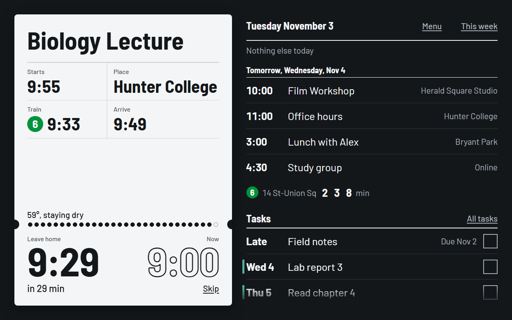
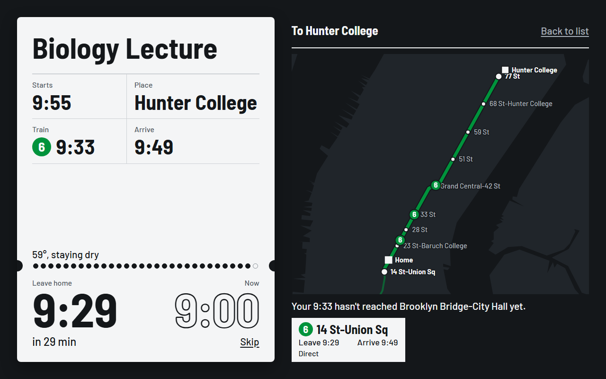
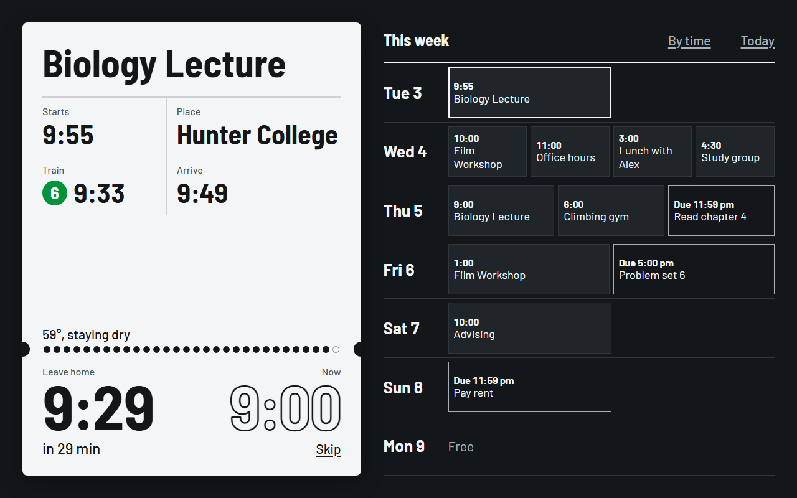
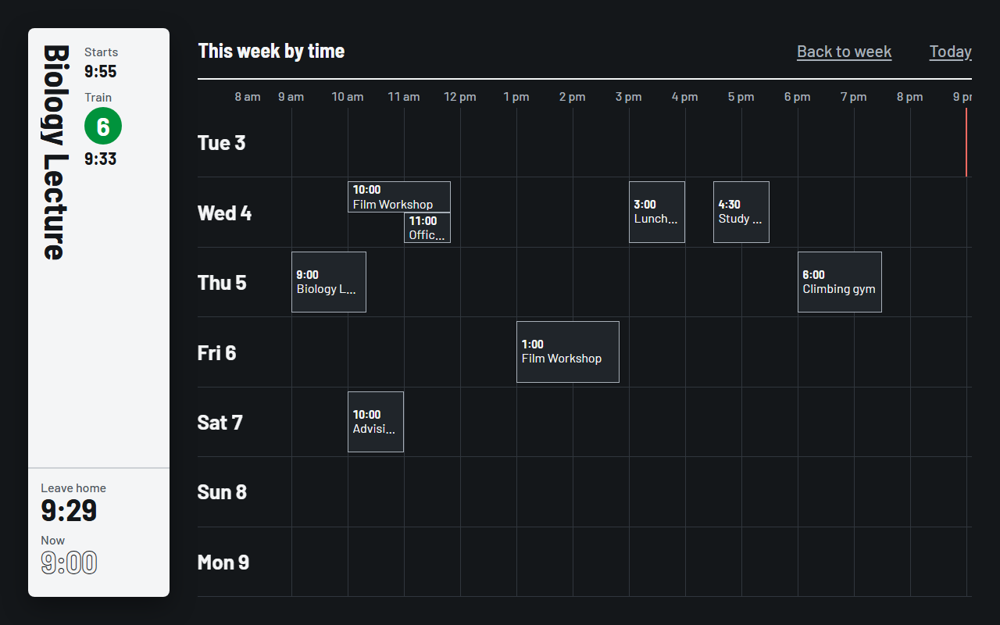
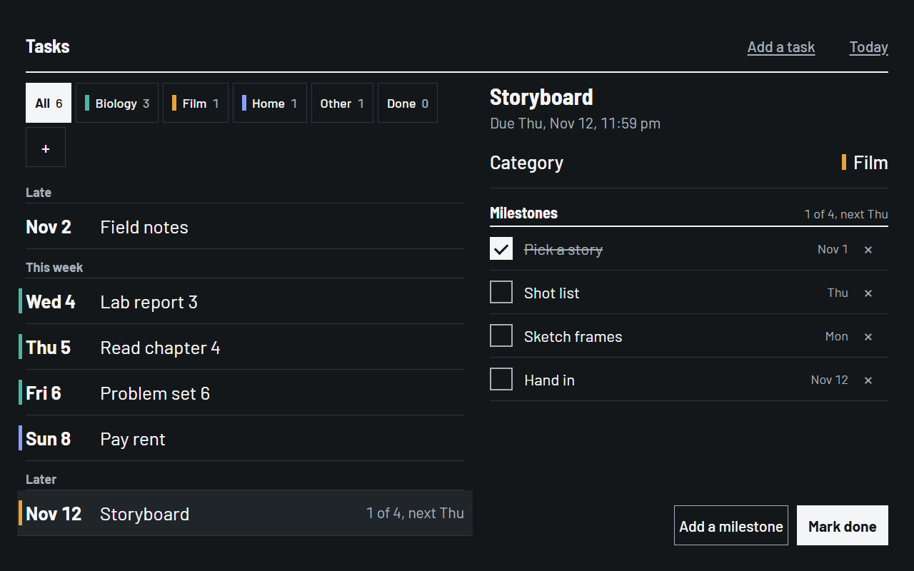
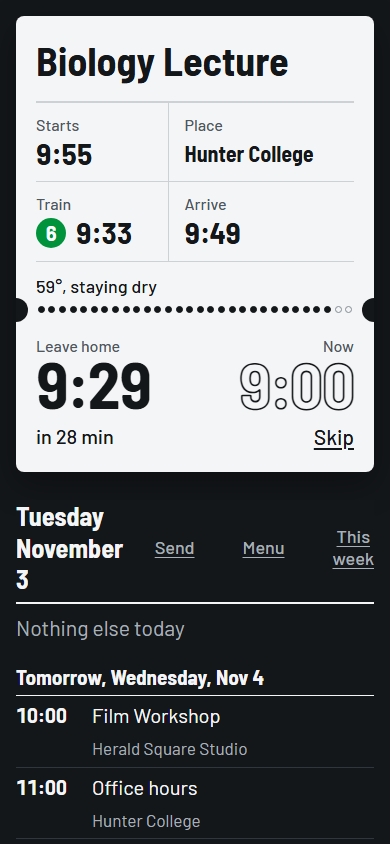

# HomeBoard

A wall screen for New York City subway riders. It answers one question at a glance: **what's next today, and when do I have to leave for it?**

HomeBoard reads your calendar and assignments, plans the trip from your front door with live MTA train times, and turns that into a leave time you can act on. It runs on a Raspberry Pi with a touch screen on the wall, and the same board opens on your laptop and phone.



## What it does

- **The next event as a boarding pass.** When it starts, where, which train to catch, when you'll arrive, and a big **Leave home** time beside the current time. A row of dots counts the minutes down, and under five minutes the bottom of the pass turns the color of your train's line.
- **Live trains.** Arrivals come straight from the MTA's real-time feeds, with no key needed. Service alerts only show when they touch your ride: your line, your direction, your stops, at the time you'd travel.
- **Every way to get there.** Tap the pass for a map of your route with trains moving on it, and the other routes side by side to pick from.
- **Your schedule and tasks.** Today's events on the right, and tasks underneath, earliest first. When today is over, it shows tomorrow.
- **The week, and beyond.** Swipe for the week, five weeks deep. Swipe again for a timeline where each event is as wide as it lasts.
- **A tasks page.** Categories with colors, milestones inside a task, hold-and-drag between categories, and a Done list to undo a mistake.
- **An optional local AI.** Paste an assignment list or say "move Biology to Thursday at 6", and it changes the board. It runs on the Pi itself through [Ollama](https://ollama.com), so nothing goes to a cloud service.
- **Weather that tells you what to do**, like "take an umbrella", and dimming at night with tap to wake.

## Screens

| Route map | Week | Week by time | Tasks |
|---|---|---|---|
|  |  |  |  |

On a phone the same board stacks into one column:



## How it works

```
Google Calendar ──┐                        ┌── wall screen (Raspberry Pi, full-screen browser)
Brightspace ──────┼──> HomeBoard server ───┼── laptop
                  │    (Node, on the Pi)   └── phone
Ollama (optional)─┘           │
                              │  the browser itself reads:
                              └── MTA real-time trains and alerts, Open-Meteo weather
```

- **The server** (`server.mjs`, `server/`) is a small Node program with one dependency. It downloads your calendar links, which browsers can't, keeps your settings and tasks in `data/board.json`, and runs the AI queue.
- **The page** (`public/`) is plain HTML, CSS and JavaScript, with no build step. It reads the MTA's feeds and the weather directly, and plans routes itself from a built-in copy of the subway map.
- **Routing** covers the whole subway: direct trains, one transfer, or walking. It works from stations rather than street addresses, so no address ever leaves your network.

## What you need

To try it, any computer with [Node.js](https://nodejs.org) 22 or newer.

For the wall:

- Raspberry Pi 5 (8 GB if you want the AI)
- The official 27 W USB-C power supply and the Active Cooler
- A touch screen, 1280×800 or larger, landscape. 1024×600 works too.
- A microSD card, 32 GB or more

## Try it on your computer

```bash
git clone https://github.com/Owllaxe/HomeBoard.git homeboard
```

```bash
cd homeboard && npm install
```

```bash
npm start
```

Open `http://127.0.0.1:4173/#wall`. The `#wall` part turns on touch mode: the on-screen keyboard, night dimming, and pages that go back to today by themselves. Leave it off on a laptop.

Without a calendar connected yet, `http://127.0.0.1:4173/?scene=morning` shows a made-up day. There's a link at the bottom left to the other scenes.

## Install it on a Raspberry Pi

[PI-SETUP.md](PI-SETUP.md) goes step by step from the box to the board on the wall: preparing the card, copying the project over, installing the AI, and fixing common problems. In short, on Raspberry Pi OS with a desktop:

```bash
cd ~/home-board && sh deploy/install-pi.sh
```

That installs Node 22, starts the server at every power-on, and opens the board full screen once it's ready.

## Set it up

Swipe right on the board, or tap **Menu**.

1. **Calendar links.** Paste your Google Calendar's private iCal address: in Google Calendar, open **Settings**, choose your calendar, and copy **Secret address in iCal format**. For Brightspace assignments, open **Calendar**, choose **Subscribe**, and paste that link too. Treat both like passwords.
2. **Home stations.** Add the stations you use and how many minutes you walk to each.
3. **Places.** Every location in your calendar appears here. Give each one its nearest station. Online events need nothing.
4. **Other settings:** dim at night, extra time before leaving, and °F or °C.

## Using it

### Moving around

| To | Do this |
|---|---|
| See the route map | Tap the pass. Tap it again, or **Back to list**, to return. |
| Look at a later event | Tap it in the schedule. The pass turns dark grey, and goes back to the next event after 10 seconds. |
| Open the menu | Swipe right. Swipe left to close it. |
| See the week | Swipe left, or tap **This week**. Scroll down for the next four weeks. |
| See the week by time | Swipe left again, or tap **By time**. The pass shrinks to make room. |
| Open the tasks page | Swipe up, scroll down with a mouse, or tap **All tasks**. |
| Go back to today | Swipe the other way, tap **Today**, or press Esc. On the wall it also goes back by itself after 30 seconds. |

Lists scroll with a finger or mouse wheel. Once a list reaches its end, the same swipe changes the page.

### The pass

White always means the next thing you leave for. Dark grey means you're looking at a different event. The dots under the event count the minutes until you leave. **Skip** takes one occurrence off the board, with Undo.

### The map

Tap the pass. The map shows your route, with live trains moving along it, and the other ways to get there in a row along the bottom, where you can tap one to pick it. The leave time on the pass follows the route you pick.

### The week

Tap any event to show it on the pass, then tap the pass for its map. In the timeline, each event is placed at its time of day and as wide as it lasts, and events that overlap share the row. A red line marks now.

### Tasks

- **Categories** come from your Brightspace courses, and you can make your own with **+**. Each has a color that shows as a small tab on the home list.
- **Hold a task for half a second** and drag it onto a category to move it.
- **Milestones** are steps inside a task with their own dates. A task rises on the home list when its next step is due sooner than the task itself.
- **Done** lists what you finished in the last two weeks, with **Not done** to put one back.

### From your laptop or phone

Phones and laptops on the same Wi-Fi can open the whole board. On the wall, open **Menu > Phone and laptop** for the address and a 6-digit code. Each device enters the code once.

On a laptop or phone, **Send** at the top of the schedule opens a panel for the AI. The address with `/send` on the end is a quick page for the same thing, handy on a phone.

## The AI (optional)

The AI runs in Ollama on the same machine. Install Ollama, download a model, and start the board with `OLLAMA_MODEL` set. On the Pi, the board's service already sets it to `qwen3.5:4b`.

```bash
ollama pull qwen3.5:4b
```

```bash
OLLAMA_MODEL=qwen3.5:4b npm start
```

On Windows PowerShell, that's `$env:OLLAMA_MODEL = 'qwen3.5:4b'; npm start`.

**Assignments** takes pasted descriptions or whole lists and adds them as tasks. **Change my schedule** takes plain requests:

- "Remind me to email Professor Lee by Tuesday"
- "Move Biology Lecture to Thursday at 6pm"
- "Add gym on Wednesday from 7 to 8am"
- "Put all the lab reports under Biology"
- "Problem set 6 is now due Friday"
- "What do I have tomorrow?"

**What to expect:**

- **It's slow on a Pi**, about 10 to 30 seconds a request, more for a long list. Messages wait their turn, so you can send and walk away.
- **It isn't perfect**, so check its changes. `qwen3.5:4b` passed 35 of 37 test messages when limited to four processor cores like a Pi. Its reply always says exactly what it changed.
- **The code does the risky parts, not the model.** It works out dates itself, only changes events and tasks your message names, changes nothing on a plain question, and refuses to guess when it isn't sure.
- **Google Calendar and Brightspace are read-only.** The AI's changes are kept on the board and laid over them, and never reach Google Calendar.
- **Repeating changes.** "Move all 8pm Math Classes in future weeks to 7pm" becomes a rule for every matching class from today on, including ones further ahead than the AI can see. **Menu > Repeating changes** lists them, with Remove to undo one.

To test a model on all 37 messages, using a throwaway board so your real one isn't touched:

```bash
node tools/test-ai.mjs qwen3.5:4b --pi
```

`--pi` uses four processor cores and no graphics card, close to a Raspberry Pi. Set `AI_DEBUG=1` to see what the model answered. Any other model can be connected by writing a provider and calling `setProvider` in `server.mjs`. The top of `server/ai.mjs` describes what a provider receives and returns.

## Privacy and security

- **Your data stays on your machine.** Links, settings, tasks and the chat are kept in `data/board.json`. That folder is in `.gitignore`, so it's never committed.
- **Calendar links never go back to a browser**, not even the board's own page.
- **Other devices need the code** before they can see anything. The code is only shown on the wall itself, and wrong guesses are slowed right down.
- **What leaves your network:** downloads of your calendar links, requests to the MTA's public feeds, and the weather for your home station's position. The AI runs locally.

To keep the board to one machine, start it with `HOST=127.0.0.1`. `PORT` and `BOARD_DATA` change the port and the data folder.

## Updating the subway data

The station list, track shapes and stopping patterns are built from the MTA's static data. When the MTA changes service, rebuild them. The steps are at the top of `tools/build-network.mjs`.

## Project layout

```
server.mjs            starts the server
server/               calendar reading, settings and tasks, the AI queue and its checks
public/               the board: page, styles, routing, map, MTA feeds, weather
deploy/               Raspberry Pi service and full-screen start-up
tools/                subway data builder and the AI test
docs/screenshots/     the pictures in this file
PRODUCT.md, DESIGN.md what the board is for, and how it looks
```

## Limitations

- **Subway only.** It doesn't route buses, PATH, LIRR or Metro-North.
- **New York City only**, because the routing is built on the MTA's data.
- **Stations, not addresses.** Each place is matched to a station by hand, once.
- **Read-only calendars.** Changes made on the board don't reach Google Calendar or Brightspace.

## Credits

- Train times, alerts and subway data: [MTA](https://new.mta.info/developers) real-time and static GTFS feeds
- Weather: [Open-Meteo](https://open-meteo.com), under CC BY 4.0
- Borough outlines: [NYC Open Data](https://opendata.cityofnewyork.us)
- Typeface: Barlow and Barlow Semi Condensed by Jeremy Tribby, under the SIL Open Font License (`public/fonts/OFL-LICENSE.txt`)
- Calendar reading: [ical.js](https://github.com/kewisch/ical.js)

## License

MIT. See [LICENSE](LICENSE).
